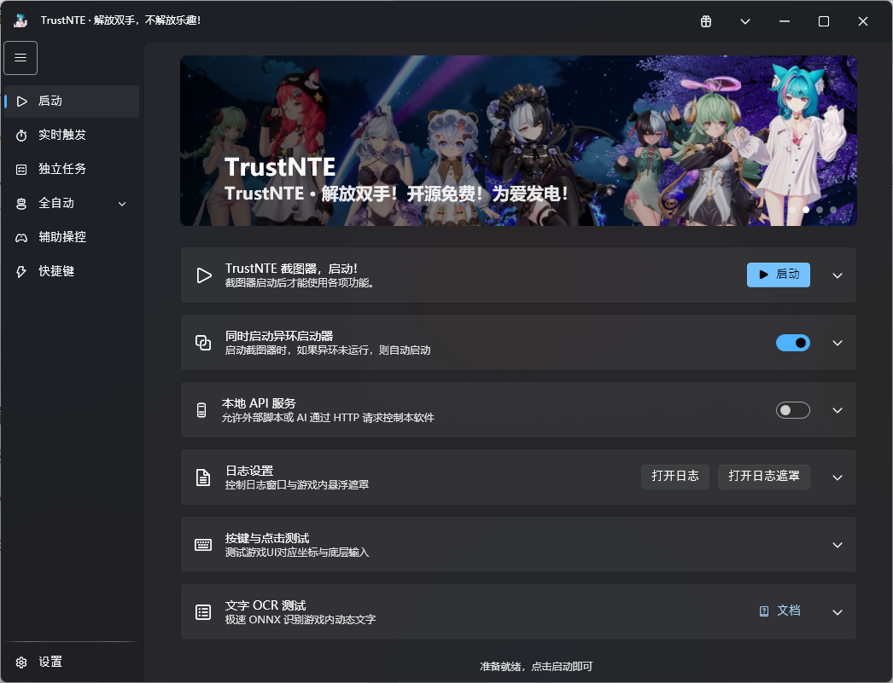
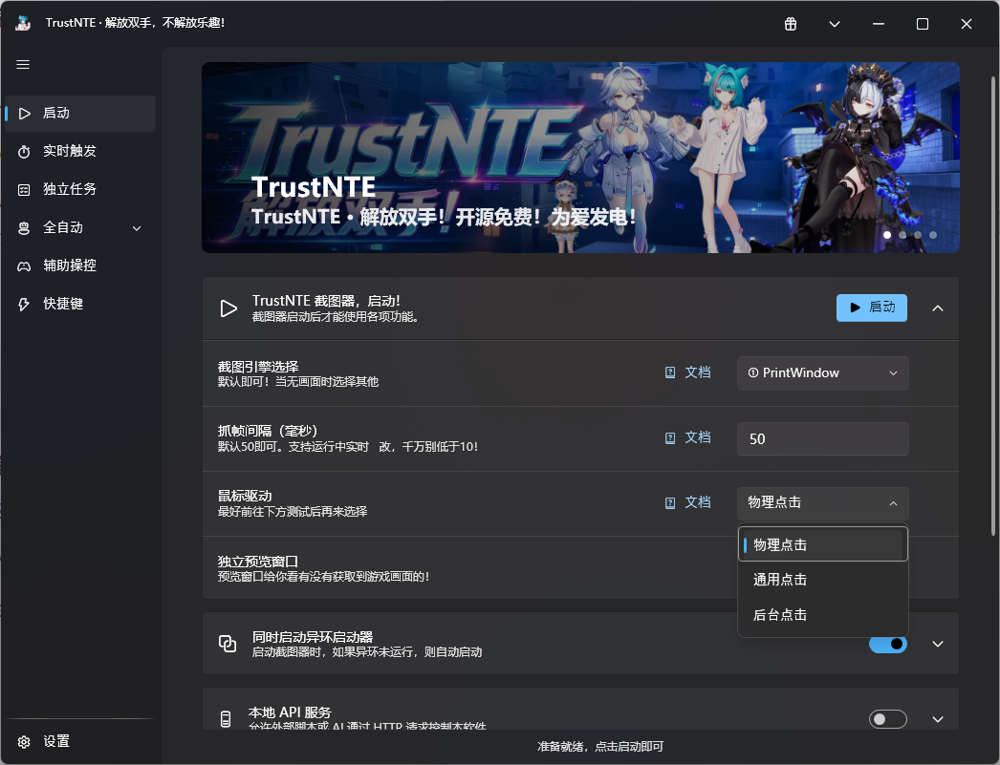

# TrustNTE解放双手 - 基于C# .NET8.0 MVVM架构编写的异环后台静默运行的自动化工具
### 专为《异环》(Neverness to Everness) 打造的开源免费辅助工具

> **让异环解放双手，把自由时间还给自己。**  
> **Free your hands, reclaim your time.**

[中文](#中文介绍) | [English](#english-introduction)

---

## 📸 软件预览 / Screenshots

  
    
  

---

## 🎮 中文介绍

TrustNTE 是一款专为《异环》（Neverness to Everness）打造的开源、免费、无广告的自动化辅助工具。本项目基于 C# .NET 8.0 和 MVVM 架构编写，致力于通过底层视觉识别和输入注入，帮助玩家后台静默完成游戏中的日常、重复性任务，极大地提升游戏体验。

### 🌟 核心特性
- 🌍 **多语言支持**：内置简体中文、English、日本語、한국어 四国语言，无缝切换。
- 🖥️ **全分辨率支持**：无论你的游戏窗口是 1080P、2K 还是 4K，底层渲染引擎会自动将画面归一化至 1080P 标准帧，确保识别精准度，**无需手动缩放**。
- 🤖 **硬核 AI 索敌**：包含基于 **YOLOv8 深度定制训练**的战斗识别模型，精准锁定敌人，告别传统找色/找图的漏检与误判。
- 🎣 **自动钓鱼**：完美还原控鱼操作，支持自动买饵、自动卖鱼，智能识别状态机。
- ⚔️ **自动战斗**：结合 YOLOv8 视觉模型与状态机，自动索敌、释放技能，支持 Q 能量自动检测。
- 💬 **自动剧情**：一键跳过对话、自动选择对话选项、智能识别并执行传送。
- 🎁 **月卡/环石领取**：最高优先级独立闹钟机制，无视任务屏蔽直接领取。
- 🏃 **粉爪拾取**：高精度 HSV 颜色识别，自动拾取掉落物。
- 🎵 **自动音游**：支持超强音全自动循环，DFJK 完美判定。

### 🚀 快速开始
1. 前往 [Releases](https://github.com/TrustNTE/TrustNTE/releases) 页面下载最新的安装包。
2. 双击安装包，按照提示完成安装。
3. 请务必**以管理员身份运行**本软件（自动化功能需要权限）。
4. 在启动页配置好游戏路径，点击“启动”绑定窗口即可。

---

## 🇬🇧 English Introduction

TrustNTE is an open-source, free, and ad-free automation tool designed specifically for *Neverness to Everness*. Built with C# .NET 8.0 and MVVM architecture, it uses advanced computer vision and input injection to silently automate daily and repetitive tasks in the background, greatly enhancing the gaming experience.

### 🌟 Key Features
- 🌍 **Multi-language Support**: Built-in Simplified Chinese, English, Japanese, and Korean. Switch seamlessly.
- 🖥️ **Full Resolution Support**: Whether your game window is 1080P, 2K, or 4K, the underlying render engine automatically normalizes frames to a standard 1080P. **No manual scaling required.**
- 🤖 **Hardcore AI Targeting**: Includes a combat recognition model custom-trained on **YOLOv8** for precise enemy locking, eliminating the miss-detections of traditional color/template matching.
- 🎣 **Auto Fishing**: Perfectly simulates fishing bar control, auto-buying bait, auto-selling fish, and smart state machine recognition.
- ⚔️ **Auto Combat**: YOLO-based vision model and state machine for auto-targeting, skill casting, and Q-energy detection.
- 💬 **Auto Dialogue**: Auto-skip dialogue, auto-select options, and smart teleport detection.
- 🎁 **Monthly Card/Stone Claim**: High-priority independent alarm mechanism, claims directly regardless of task blocking.
- 🏃 **Pink Paw Pickup**: High-precision HSV color recognition for auto-looting.
- 🎵 **Auto Rhythm Game**: Full auto-loop for the rhythm minigame with perfect DFJK judgments.

### 🚀 Quick Start
1. Go to the [Releases](https://github.com/TrustNTE/TrustNTE/releases) page to download the latest installer.
2. Double-click the installer and follow the prompts.
3. **Run as Administrator** (Required for automation functions).
4. Configure the game path on the startup page, click "Start" to bind the window, and you're good to go!

---

## 🛠️ 技术栈 / Tech Stack
- **UI**: WPF + Wpf.Ui (Fluent Design)
- **Framework**: .NET 8.0 + MVVM (CommunityToolkit.Mvvm)
- **Vision**: OpenCvSharp4, RapidOCR
- **AI Model / 目标检测**: **YOLOv8** (Custom Trained / 深度定制训练)
- **Input Driver**: Physical, Background, Trick injection (Anti-key-stuck built-in)

## ⚠️ 免责声明 / Disclaimer
1. **仅供学习交流与个人技术研究使用，完全开源免费，严禁倒卖或商业用途。**  
   *For learning and technical research only. Open-source and free. Commercial use is strictly prohibited.*
2. **使用本工具产生的任何游戏账号封禁、数据丢失等后果，由使用者自行承担。**  
   *Users bear full responsibility for any account bans or data loss.*
3. **本项目不提供任何游戏内购破解功能，亦不与官方产生任何关联。**  
   *This project does not provide any in-app purchase cracking and is not affiliated with the official developers.*

## 🤝 贡献与反馈 / Contribution
欢迎提交 Issue 或 Pull Request 来帮助完善这个项目。如果你觉得这个项目对你有帮助，请给个 **Star ⭐️** 支持一下！  
*Feel free to submit Issues or PRs. If this project helps you, please give it a **Star ⭐️**!*